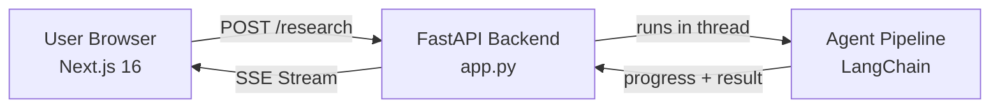
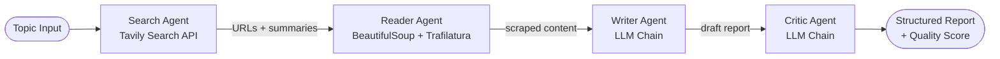
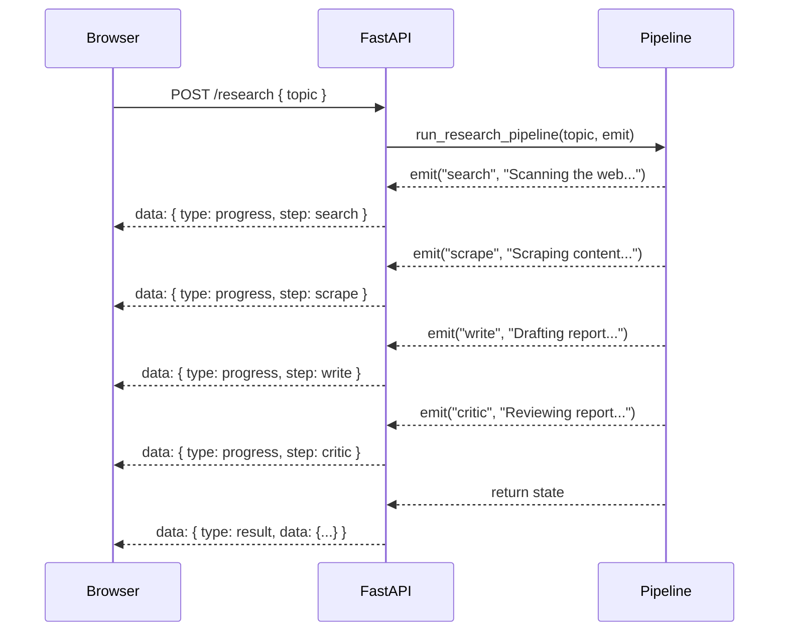

# Langchain MultiAgent Research System

An AI-powered research automation system that uses a pipeline of four specialized agents to search the web, scrape content, write structured reports, and critically evaluate them — all from a single topic input.

---

## The Problem It Solves

Manual research is slow. You search, open tabs, read through pages, take notes, synthesize information, write a summary, and then second-guess the quality of what you produced. This system automates that entire workflow end-to-end.

You type a topic. Four agents handle the rest — in sequence, with live progress updates — and deliver a structured report with a quality score attached.

---

## System Architecture

The system is split into three layers:



---

## Agent Pipeline

Four agents run in a fixed sequence, each with a specific responsibility:



| Agent | Tool | Responsibility |
|-------|------|----------------|
| Search Agent | Tavily Search API | Queries the web and returns titles, URLs, and summaries |
| Reader Agent | BeautifulSoup + Trafilatura | Picks the most relevant URL and scrapes its full content |
| Writer Agent | LLM Chain | Synthesizes search + scraped data into a structured report |
| Critic Agent | LLM Chain | Reviews the report and returns a score, strengths, and weaknesses |

---

## Streaming Flow (SSE)

Progress updates are streamed from the backend to the frontend in real time using Server-Sent Events:



---

## Tech Stack

| Layer | Technology |
|-------|-----------|
| LLM | Groq (`openai/gpt-oss-120b`) |
| Agent Framework | LangChain |
| Web Search | Tavily |
| Web Scraping | BeautifulSoup4, Trafilatura |
| Backend | FastAPI, Uvicorn |
| Frontend | Next.js 16, Tailwind CSS, TypeScript |
| Streaming | Server-Sent Events (SSE) |

---

## Project Structure

```
Langchain-MultiAgent-Research-System/
├── src/
│   ├── agents/
│   │   └── agents.py        # Agent and chain definitions
│   ├── pipelines/
│   │   └── pipeline.py      # Sequential pipeline with SSE emit support
│   └── tools/
│       └── tools.py         # web_search and web_scrapper tools
├── frontend/
│   └── app/
│       ├── page.tsx         # Main UI
│       ├── layout.tsx       # Root layout
│       └── globals.css      # Global styles
├── app.py                   # FastAPI server
├── main.py                  # CLI entry point
├── .env                     # API keys
└── requirements.txt
```

---

## Installation

### 1. Clone the repository

```bash
git clone https://github.com/ymikenzy55/Langchain-MultiAgent-Research-System.git
cd Langchain-MultiAgent-Research-System
```

### 2. Create and activate a virtual environment

```bash
python -m venv venv

# Windows
venv\Scripts\activate

# macOS/Linux
source venv/bin/activate
```

### 3. Install Python dependencies

```bash
pip install -r requirements.txt
```

### 4. Set up environment variables

Create a `.env` file in the root directory:

```env
GROQ_API_KEY=your_groq_api_key
TAVILY_API_KEY=your_tavily_api_key
```

- Get a Groq API key at [console.groq.com](https://console.groq.com)
- Get a Tavily API key at [tavily.com](https://tavily.com)

### 5. Install frontend dependencies

```bash
cd frontend
npm install
```

---

## Running the System

### Start the backend

```bash
# From the project root with venv activated
venv\Scripts\uvicorn app:app --reload --port 8080
```

### Start the frontend

```bash
# In a separate terminal
cd frontend
npm run dev
```

Open [http://localhost:3000](http://localhost:3000) in your browser.

---

## CLI Usage

To run the pipeline directly without the frontend:

```bash
python main.py
```

Edit the `topic` variable in `main.py` to change the research subject.

---

## Notes

- The model has a token-per-minute (TPM) limit on Groq's free tier. The pipeline includes a 20-second delay before the critic step to avoid rate limit errors.
- Some websites block automated scraping. The scraper falls back to `trafilatura` when `requests` is blocked.
- For best results, use specific and well-defined research topics.
